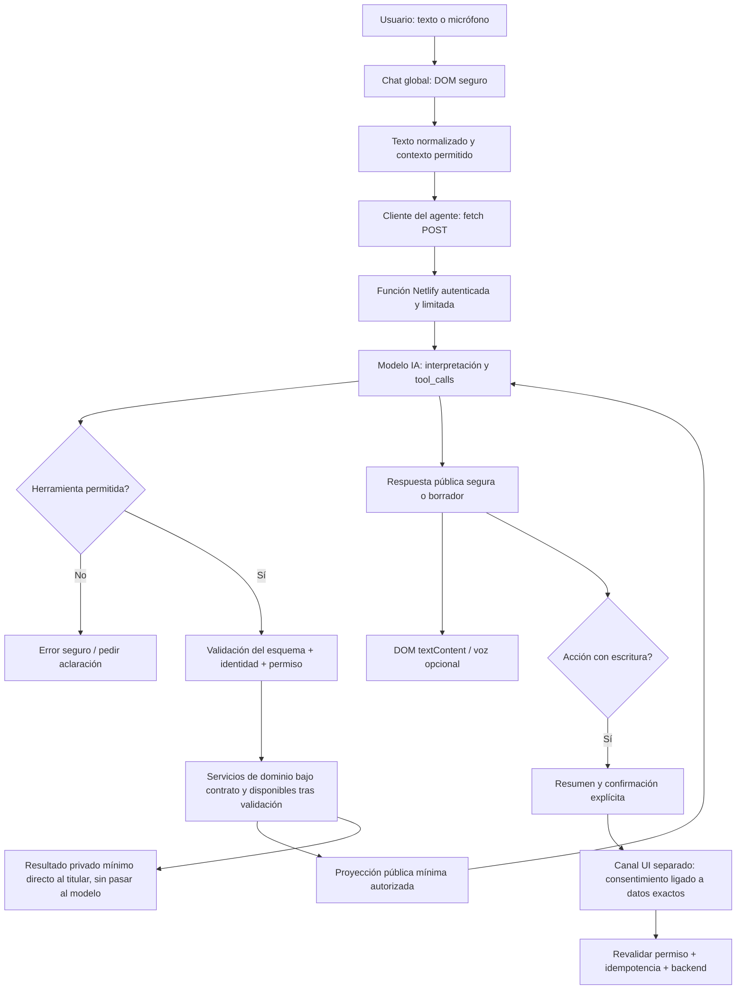

# CONTRATO_AGENTE_GLOBAL_TB4 — CampusLoop V2

**Revisión propuesta:** acompaña SPEC v1.1 — 21/11/2026 (Perú); primer contrato del agente global, sin aprobación final.\
**Estado:** PROPUESTA PARA REVISIÓN; no implementado ni habilitado.\
**Motivo del cambio:** acuerdo oral con el docente: reemplazar el bloque de IA en Publicar por un **agente global flotante**, con conversación por texto/voz, contexto local y acciones autorizadas.\
**Base del proyecto:** `SPEC_TB4.md` v1.0, `develop` `472697e250a61d8f54ae77c2aee1ab824141012e`; conservar contratos de REST/DTO/Supabase.\
**Regla:** documentar no autoriza implementación, staging, commit, push, merge, consumo de IA, Netlify ni Supabase. La rama documental está autorizada por la tarea, no por este documento. Contratos de operaciones futuras se acuerdan con sus propietarios antes de programar.

**Clasificación:** **[DOCENTE ORAL / ACUERDO ORAL]** identifica el alcance comunicado por coordinación; **[PROPUESTA]** identifica nombres, interfaces, mecanismos y cifras por ratificar; **[PENDIENTE]** identifica dependencias y pruebas no demostradas; **[IMPLEMENTACIÓN HISTÓRICA]** describe código inspeccionado que se conserva; **[ADICIONAL]** identifica TTS y extras. No confundir estados ni presentar este chat como implementado o desplegado.

**Precisión de cierre 1.1 confirmada por coordinación:** se conserva el agente global y se aclara el modelo de reputación sin pasarela. La nueva indicación oral de `pages/` por funcionalidades y consolidación progresiva de estados sustituye mantener permanentemente los 14 HTML en raíz. **[PROPUESTA DE MIGRACIÓN]** identifica mapas/fusiones por ratificar, no el árbol actual ni permiso para mover archivos. El agente cubrirá todas las páginas y vistas finales del inventario aprobado; Landing incluida mientras se mantenga ese alcance, sin exigir 14 archivos físicos separados. `index.html` puede permanecer como entrada Landing/hosting según revisión Netlify. Véanse [SPEC §§2, 5 y 6.6](../SPEC_TB4.md).

## 1. Objetivo y frontera

CampusLoop contará con un agente conversacional disponible **en todas las páginas y vistas finales incluidas en el inventario de rutas aprobado**, incluida Landing mientras se mantenga el alcance global, mediante botón flotante inferior derecho. El agente combina respuestas generadas con herramientas del dominio que leen datos reales o preparan acciones. No será un chatbot estático ni una simulación de cuenta, reservas o intercambios; su cobertura es funcional, independiente del número de HTML y de estados consolidados.

Capacidades del alcance oral confirmado: (a) buscar artículos por filtros y recomendar opciones sustentadas en resultados; (b) consultar datos de la **propia cuenta**, reservas e intercambios realmente registrados cuando exista servicio autorizado; (c) recopilar datos para una publicación desde cualquier página/vista aprobada; (d) consultar el estado de vendedor; (e) continuar en la vista final de Publicar con datos precompletados y, tras confirmación explícita y controles efectivos, persistir un artículo. Mantener título ≤100 y descripción ≤1000 de US17 como **capacidad del agente**, editable/aceptable/descartable/restaurable sin perder originales ni inventar características; no bloque exclusivo ni dependencia permanente de `/publicar.html`. Si falta servicio o autorización, informar integración pendiente y mantener el criterio pendiente; no reemplazarlo por un mock ni declarar el mínimo cumplido. Toda escritura requiere contrato operativo, confirmación humana expresa y autorización backend; disponer de herramientas no concede poderes arbitrarios.

No renumerar las 20 User Stories. US18/categoría automática y la personalización avanzada de US19 siguen adicionales; seleccionar y explicar artículos de una consulta real sí integra este mínimo oral, sin acreditar toda US19.

**Modelo sin pasarela, confirmado por coordinación:** CampusLoop no procesa pagos, inicia cobros, mueve fondos ni confirma transferencias monetarias. Los estudiantes acuerdan/realizan pago y entrega física fuera del sitio; dentro se gestionan artículos, reservas, conversaciones, encuentros y estados/confirmaciones autorizados de intercambios. No se incluyen pagos reales/simulados dentro de la plataforma, Premium, suplantación, aprobación automática de vendedor, control arbitrario del DOM o datos privados ajenos. Ante «compras recientes», consultar únicamente reservas/intercambios realmente registrados y autorizados, explicando qué dato acredita el servicio; no inventar compras, pagos, ventas ni intercambios completados ni deducirlos de una reserva.

**Reputación básica pertenece al dominio, no es un extra genérico:** comentarios y estrellas de compradores/vendedores, asociados a experiencias válidas. Elegibilidad, confirmación de intercambio, persistencia, permisos/restricciones y eventual moderación siguen pendientes de contrato operativo con Bernabé/coordinación y consumidores. Prohibir autoevaluaciones y duplicados por intercambio/evaluador; reservar no equivale a completar. El agente podrá consultar reputación pública cuando exista un servicio válido, sin inventar reseñas/medias/contadores; no crea calificaciones/comentarios en nombre del usuario ni cierra intercambios sin contrato y autorización específicos. Este documento no elige tablas/índices/RPC/columnas ni crea un contrato de reputación independiente. Niveles avanzados, insignias y gamificación pueden seguir adicionales. Alcance deseado y compromiso ejecutable TB4 se distinguen en SPEC §2.5/§6.6; ninguna función queda implementada por documentarla.

## 2. Fuente académica y estado

- **[DOCENTE ESCRITO, S12]** DOM/eventos, validaciones y almacenamiento navegador.
- **[DOCENTE ESCRITO, S13]** `fetch`, JSON, `async/await`, `try/catch`, `response.ok` y presentación segura con `textContent`.
- **[DOCENTE ESCRITO, S14]** IA externa real a través de API, protección de claves por proxy en producción, despliegue y consolidación.
- **[DOCENTE ORAL, comunicado por coordinación]** chat global, voz en navegador, flujo de voz demostrable, localStorage para recordar el hilo, acciones de cuenta/reservas/catálogo/publicación, inspección de HTML/DOM, informe completo y retirada controlada de lo innecesario.
- **[DOCENTE ORAL, incentivo]** respuesta hablada por navegador como puntos adicionales, sujeto a soporte.
- **[ACUERDO DEL EQUIPO CON EL PROFESOR, oral]** sustituir el bloque de IA en Publicar por un botón flotante global en la parte inferior derecha.
- **[DOCENTE ORAL / ACUERDO ORAL, nueva indicación comunicada por coordinación]** HTML en `pages/` por funcionalidades y consolidación progresiva de estados del mismo recorrido, sustituyendo la permanencia en raíz; mapa/fusiones pendientes de autorización específica. No consta aquí como instrucción escrita del enunciado.
- **[ACUERDO DE COORDINACIÓN]** modelo sin cobros/pasarela y reputación mutua por comentarios/estrellas; contrato operativo de intercambios/elegibilidad con Bernabé pendiente, sin simulaciones ni ampliación de privilegios.

La atribución escrita se conserva del SPEC aprobado y del análisis `REVISION_MATERIALES_SEMANAS_12_13_14.md`, que sintetiza 19 fuentes; esta tarea no reinspecciona los 19 originales ni convierte sus ejemplos en código aprobado. Se lee además `PROPUESTA_ACTUALIZACION_SPEC_TB4.md`. No atribuir al PDF una obligación que llegó oralmente. Registrar en el informe el acta o captura si luego se recibe. TTS adicional no modifica por sí solo el puntaje escrito de la rúbrica.

## 3. Arquitectura de confianza y servicios



**Separación obligatoria:**

- Navegador: micrófono/voz, texto, render, estado visual, navegación y almacenamiento local **no sensible**. Nunca interpreta un tool-call como instrucción JS ejecutable ni usa una sesión de localStorage para autorizar operaciones.
- `js/auth.js`/`js/supabase-cliente.js`: fuente de sesión SDK oficial, sin cliente duplicado.
- Función Netlify: credencial de IA en variable de entorno, autenticación real, validación de herramientas/entradas/salidas, límites y orquestación. La interfaz no manda un cuerpo arbitrario directo al proveedor.
- Bernabé: servicios del dominio, PostgreSQL, RLS/GRANTS, transacciones RPC y autorizaciones; las herramientas consumen contratos confirmados, no imitan backend en browser.
- Matías: UI de Publicar, permisos visuales, aplicación controlada de borradores y fotografía mediante Storage; conserva autoría de sus archivos.
- Maricielo: `js/localstorage.js` reusable; UI de Cuenta/Reservas según sus tareas.

La migración física de HTML no cambia esta arquitectura, el cliente único, PostgreSQL, REST/DTO, RLS/GRANTS, Storage o Realtime. Ángel coordina rutas/build y agente; cada propietario adapta su interfaz en tareas/PR acordados, sin transferirle todos los HTML. Componente reutilizable de apertura/cierre, navegación, restauración del contexto permitido y limpieza de listeners/solicitudes, compatible con multipágina y cambios de estado JS; nombres/selectores nuevos siguen provisionales.

**Frontera servidor/navegador [PENDIENTE]:** consumir contratos existentes no significa importar automáticamente módulos de navegador en Netlify. Bernabé y Ángel deben acordar adaptadores compatibles con Node, actor/RLS y proyección mínima, sin repetir consultas/normalización en el widget, inventar otro servicio REST o cambiar el DTO. No usar el singleton de sesión del navegador como cliente servidor compartido entre solicitudes.

**Proveedor [PENDIENTE]:** mantener NVIDIA NIM como candidato actual, sin pasar a OpenAI por copiar el ejemplo del profesor. No hay proveedor/modelo ratificado para este agente: comprobar tool-calling, español, cuota gratuita real y condiciones para demo pública, sin prometerlos por una ficha o clave. Presupuesto S/ 0; prueba/consumo requieren autorización.

**[IMPLEMENTACIÓN HISTÓRICA]** El código inspeccionado contiene `js/asistente.js`, `netlify/functions/asistente.mjs` y tests offline de sugerencia singular, con IA apagada y handler sin controles ensamblados (503 para POST). Se conserva intacto. **Supersedidos para la arquitectura futura:** operación `proponer_publicacion`, `/api/asistente`, eventos `campusloop:ia-solicitar`, `campusloop:ia-estado`, `campusloop:ia-aplicar` y UI exclusiva de Publicar. No se borran tests/README/código ni su historial y no se redirige silenciosamente la ruta. `POST /api/agente` es **[PROPUESTA]**, no endpoint creado ni habilitado. El adaptador `netlify/lib/auth-usuario.mjs` ya prepara verificación de identidad por inyección, sin demostrar SDK servidor conectado, vendedor/cuota ni agente real.

## 4. Widget global: DOM, navegación y accesibilidad

- Botón flotante inferior derecho visible en **todas las páginas y vistas finales incluidas en el inventario de rutas aprobado**, con Landing mientras se mantenga el alcance acordado; sin tapar navegación móvil, CTA, avisos ni elementos sticky. No usar z-index extremo sin revisión ni asumir 14 HTML separados.
- **Inventario actual/histórico, no estructura final:** `index.html` (también `/`), `login.html`, `registro.html`, `inicio.html`, `explorar.html`, `detalle.html`, `perfil-vendedor.html`, `activar-vendedor.html`, `activar-vendedor-activo.html`, `publicar.html`, `publicar-exito.html`, `reservas.html`, `reservas-consulta.html`, `cuenta.html`. Las 14 correspondencias, destinos propuestos, independencia/fusiones y riesgos están en SPEC §5.1–5.4; `pages/` no está migrado. Una URL de activo/éxito no concede autorización ni acredita publicación.
- Navegación del agente mediante inventario aprobado y datos/IDs validados: compatible con subcarpetas `pages/`, enlaces profundos, estados consolidados, acceso directo y atrás/adelante. No fijar aquí destinos definitivos de Publicar, Reservas o Cuenta, ni reutilizar rutas antiguas rígidas/URLs generadas por el modelo. Propuesta de resolución desde origen/base controlada y compatibilidad en SPEC §5.4; sin perder contexto permitido ni confundir memoria con Auth.
- Botón con nombre accesible y estado `aria-expanded`, `aria-controls`; panel con encabezado, cierre, región de mensajes `aria-live`, formulario de texto, envío, botón micrófono y opción de voz de salida cuando soporte.
- Uso por teclado: Tab, Enter, Escape, foco visible, devolver foco al botón al cerrar; no secuestrar foco ni provocar scroll horizontal en 320–1920 px.
- Generar o insertar el HTML compartido desde un módulo único (p. ej. `js/agente-ui.js` de Ángel) y documentar exactamente dónde se crean nodos con `createElement`, cómo se seleccionan con `querySelector` y dónde `addEventListener` recibe eventos. No reproducir un bloque HTML/JS distinto en cada página.
- Mensajes de usuario, datos de herramientas y modelo mediante `textContent`/`.value`; no `innerHTML` ni Markdown/HTML activo, enlaces arbitrarios, iframes o código generado ejecutable.
- Mostrar origen y estado: «Preparando…», «Consultando…», «Requiere iniciar sesión», «Necesito confirmar», «Sin resultados», «Error», «Sin soporte de voz». Diferenciar recomendación de dato real comprobado.
- En Landing/Login/Registro: widget visible y guía estática honesta antes de autenticarse; por defecto **sin llamadas anónimas al modelo ni herramientas privadas**. Cualquier excepción futura de IA anónima requiere aprobación específica y protección de abuso/cuota, no queda autorizada por este contrato.
- Montaje/cleanup seguro por ruta y `pagehide/pageshow`/bfcache según patrón existente; no listeners duplicados ni respuestas obsoletas en una página nueva.
- En una misma página consolidada, cambiar de estado también debe actualizar contexto visual autorizado, foco/ARIA y operaciones pendientes sin montar el widget repetidamente. El contexto privado se revalida por sesión/servicio y no se conserva como evidencia de un intercambio o calificación.

## 5. Entrada por voz y salida hablada

**Requisito oral de entrada:** voz desde móvil o desktop gestionada por Web Speech API del navegador:

1. El usuario abre el panel y pulsa 🎤 mediante interacción explícita.
2. Detectar `window.SpeechRecognition || window.webkitSpeechRecognition`; si no hay soporte, el chat por teclado sigue disponible.
3. Informar permiso del micrófono. Configurar español (`es-PE` si funciona, otro español compatible como alternativa). Manejar `not-allowed`, `no-speech`, abortos y finalización.
4. La transcripción aparece como **texto visible y corregible**; enviar exige otra acción explícita. El endpoint del agente recibe texto, no audio ni grabación. No persistir audio. Una activación/stop no debe duplicar solicitudes.
5. Mostrar el mensaje y el resultado. No asumir reconocimiento local/offline: el navegador puede enviar audio al servicio de reconocimiento. Informar esa limitación y ofrecer texto.
6. El cierre del panel, la navegación o el logout detienen reconocimiento y cancelan peticiones pendientes.

**[ADICIONAL] Respuesta hablada:** detectar `speechSynthesis` y `SpeechSynthesisUtterance`; permitir interruptor explícito «Leer respuesta», con voz española disponible o fallback. Cancelar reproducción al cerrar, iniciar micrófono, navegar o cerrar sesión; no leer tokens ni datos privados automáticamente. Toda lectura privada requiere decisión explícita sobre ese contenido. Disponibilidad/ejecución de síntesis depende del navegador y sus voces; no garantizar procesamiento local. La ausencia de TTS no bloquea texto, entrada de voz soportada ni despliegue mínimo.

## 6. Memoria conversacional: `localStorage` (no base de datos)

**Objetivo:** recordar el hilo entre mensajes, navegación y recarga, verificable en DevTools, sin convertir el navegador en fuente de verdad del negocio.

**[PROPUESTA] inicial para ratificar con Maricielo:** `campusloop_tb4_v1_agente_historial_<usuarioId>`; visitante sin login usa memoria efímera, sin cuentas ficticias. El selector de memoria corresponde al usuario del SDK resuelto, no a un ID elegido por query/prompt; ese aislamiento del navegador nunca prueba identidad al servidor.

- Solo guardar turnos/fragmentos **no sensibles** necesarios para continuidad conversacional: rol permitido (`user`/`assistant`), texto acotado, fecha, versión. No persistir mensajes de herramientas que contengan cuenta, reservas, pagos, correos, teléfono, dirección, nombre completo, contraseñas, tokens o resultados privados. Resumir estados públicos cuando corresponda.
- **Frontera de privacidad:** texto libre de usuario/modelo también puede contener datos sensibles, aunque no sea un mensaje `tool`. No guardar automáticamente el hilo completo ni resúmenes de resultados privados. Persistir solo fragmentos/contexto explícitamente clasificados mediante campos permitidos como públicos/no sensibles; ante duda o ausencia de esa clasificación, mantener el turno efímero y avisarlo. Una regex o la afirmación del modelo no garantiza desidentificación. La aceptación AG-03 debe comprobar ejemplos con PII y su exclusión, además de un hilo público que sí persiste.
- Diseño de retención propuesto: máximo 20 turnos y 24 KiB por cuenta, con TTL de 7 días; **cifras a aprobar y probar con el equipo**, no requisito textual docente. Al expirar, invalidar versión o borrar conversación, limpiar solo sus claves. La política de logout se acuerda según la regla siguiente.
- Manejar cuota, JSON corrupto, almacenamiento deshabilitado y datos malformados mediante degradación a memoria de sesión; interfaz nunca pierde el mensaje que se está escribiendo.
- La UI indica que recuerda contexto permitido **en este navegador/origen** y ofrece «Borrar conversación». Logout/cambio de cuenta debe cerrar/cancelar, borrar datos privados efímeros y desasociar la memoria anterior antes de renderizar la nueva; ni voz ni respuestas tardías pueden revelar el otro usuario. Acordar con Maricielo si también se elimina el historial público persistido o su retención requiere nueva elección explícita; mientras no haya política aprobada no habilitar esa persistencia.
- No guardar rol vendedor, permisos, compras, intercambios/reservas como registros de negocio, calificaciones como fuente autoritativa, lista de artículos, conversaciones reales, mensajes privados ni claves internas del SDK.
- La memoria puede ayudar a interpretar «ese artículo», pero no demuestra que exista, siga disponible, se haya intercambiado ni que el usuario tenga permiso para publicar/calificar. Las herramientas reconsultan fuentes reales; navegar/recargar o restaurar contexto no ejecuta intenciones antiguas ni confirma escrituras.

**Sesión SDK, excepción separada:** Supabase JS administra su propia sesión del navegador, persistencia/refresh incluidos según Auth. `localstorage.js` y el agente no guardan, copian, renuevan ni inspeccionan manualmente JWT/refresh tokens. El cliente servidor no persiste sesiones. Memoria conversacional, borradores y sesión SDK tienen finalidades distintas; la sesión SDK no es la única evidencia académica de LS.

## 7. Herramientas y autorización por intención

La IA solo puede solicitar herramientas **registradas en una lista permitida** y con argumentos JSON bajo esquema. No se ejecuta la cadena `nombre` por evaluación dinámica ni se hacen consultas SQL/REST arbitrarias a partir del prompt.

| Herramienta provisional | Efecto | Identidad/permisos | Servicio propietario |
|---|---|---|---|
| `buscar_articulos` | Leer filtros, resultados/ID reales | Visibilidad definida por RLS | `articulos.js` Bernabé |
| `recomendar_articulos` | Seleccionar resultados reales + explicación honesta | Misma visibilidad de búsqueda | `articulos.js` Bernabé + IA Ángel |
| `consultar_mi_cuenta` | Datos propios mínimos autorizados | Sesión válida; actor del SDK/backend | `perfiles.js` Bernabé; UI Cuenta Maricielo |
| `consultar_mis_reservas` | Solo reservas del actor | Sesión válida + RLS/GRANTS | `reservas.js` Bernabé; UI Maricielo |
| `consultar_estado_vendedor` | Saber si puede publicar | Sesión y decisión de backend | Servicio perfiles/activación Bernabé |
| `preparar_borrador_publicacion` | Recopilar/normalizar datos, **sin escribir artículo** | Sesión; permiso de vendedor para avanzar | `publicaciones.js` Matías + agente Ángel |
| `consultar_publicaciones_propias` | Listar IDs/estados del vendedor | Sesión y dueño verificado | `articulos.js` Bernabé |
| Lectura de intercambios propios **[PENDIENTE, sin nombre/firma ratificados]** | Consultar solo estados/experiencias realmente registrados, sin deducir pagos o cierre de una reserva | Identidad/participación y permiso de servicio/RLS | Contrato operativo futuro Bernabé; consumidores coordinados |
| Lectura de reputación pública **[PENDIENTE, sin nombre/firma ratificados]** | Comentarios/estrellas autorizados, sin medias/reseñas inventadas ni escritura | Solo proyección pública válida; no revelar datos privados | Servicio de reputación futuro, a coordinar con Bernabé |

Nombres y firmas **[PROPUESTA]**, no ratificados; no importar funciones inexistentes. `consultar_publicaciones_propias` no concede editar/borrar. **`confirmar_publicacion` queda fuera del registro del modelo**: si se conserva ese nombre, designa solo la acción humana del canal UI/backend separado de §8; el modelo no puede invocarla ni generar consentimiento válido.

No permitir que un prompt de la descripción de un artículo se eleve a instrucción del agente. Limitar pasos de herramienta por turno (propuesta ≤4), respuesta total, tamaño de argumentos, tiempos y consumo; cifras pendientes de aprobación y prueba, no cuota efectiva. Fallos seguros sin exponer credenciales, SQL ni prompts internos. Tool-calling requiere prueba específica del proveedor/modelo.

**Compatibilidad contractual, sin redefinir DTO:** búsqueda utiliza la firma `consultarCatalogo(filtros, { signal })` y `{ ok, datos, error }` de [catálogo](CONTRATO_ARTICULOS_CATALOGO_TB4.md), con todos sus campos normalizados: `busqueda`, `categorias`, `universidad`, `campus`, `estados`, `condiciones`, `precioMinimoCentimos`, `precioMaximoCentimos`, `orden`. Sin omitir filtros ni aceptar expresiones SQL/PostgREST del modelo. Mantener UUID, enteros seguros en céntimos/PEN, nombres públicos y `imagen` lógica normalizada desde las siete columnas físicas; no inventar categoría, campus, precio, fotos, propietarios ni totales globales. Conservar validación HTTPS/origen permitido de fotos y enlaces de detalle basados en ID, nunca links libres del modelo. Precio cero/tipo SQL, límite 2 MiB y paginación siguen pendientes según aquel contrato; este agente no los resuelve.

La cuenta y reservas propias se leen con actor derivado de Auth y RLS/GRANTS. No se envían por defecto sus textos/DTO privados al proveedor: una salida determinista mínima se muestra directamente al titular y no se persiste ni narra automáticamente. El modelo puede recibir solo estado abstracto no sensible necesario; ampliar campos exige revisión explícita de privacidad. No añadir parámetros públicos ni privilegios a las siete funciones de [Auth/perfiles](contratos/CONTRATO_AUTH_PERFILES_TB4.md); obtener tokens para transporte mediante el cliente SDK compartido en memoria no convierte sus respuestas reducidas en sesiones crudas.

## 8. Flujo de publicar desde cualquier pantalla

**Caso de evaluación de ejemplo:** «Quiero publicar una calculadora Casio usada, a S/ 75».

1. **Intento:** desde cualquier página, por texto o voz; el agente solicita datos no proporcionados y comprueba sesión oficial.
2. **Permiso:** consulta estado vendedor real. Si no está aprobado, detiene ejecución y ofrece la vista de activación del inventario de rutas aprobado y estado de revisión; nunca aprueba automáticamente ni asume la permanencia de `/activar-vendedor.html`.
   Se conserva una cuenta de estudiante con capacidades de comprador y vendedor adicional, basada en `perfiles.vendedor_activado` protegido. No confiar en metadatos editables ni roles escritos en el chat. No alterar la revisión humana, los estados pendientes, 48 horas corridas sin autoaprobación y notificación interna (no correo de aprobación) de la propuesta de coordinación; sus servicios/permisos aún requieren implementación/revisión propia.
3. **Recopilación:** título, descripción, categoría/UUID, condición, precio en céntimos PEN, campus y **una fotografía real**; no inventa campos, categoría, campus o imágenes. Pregunta qué falta.
4. **Transferencia:** prepara un borrador no sensible para el controlador de Matías y navega a la **vista final de Publicar del inventario aprobado**, sin asumir la permanencia de `/publicar.html`. Muestra formulario precompletado solo con campos permitidos por contrato y datos validados, sin parámetros privados ni navegación arbitraria.
5. **Validación y vista previa:** fotografía requiere selección manual con `input type=file`; validar información/foto mediante las reglas reales (ningún audio crea una foto auténtica). El usuario ve resumen, puede editar/cancelar y el formulario conserva sus validaciones; título/descripcion sugeridos pueden editarse/descartarse.
6. **Confirmación:** acción visible e inequívoca «Confirmar publicación» con resumen final (no inferir consentimiento a partir del plan del modelo). Puede originarse en chat, pero confirmar desde UI vinculada al estado real.
7. **Ejecución:** servicio revalida sesión, `vendedor_activado`, RLS/GRANTS, datos/importe/foto y referencia de consentimiento/idempotencia; no confiar en aprobación previa del LLM. Solo entonces escribir. Sin foto, contrato CRUD o políticas, mostrar «Integración pendiente» sin crear nada.
8. **Resultado:** únicamente tras persistencia confirmada, estado visual de publicación confirmada con ID backend y enlace aprobado al artículo; puede ser una vista consolidada, no se exige `publicar-exito.html`. Fallo conserva borrador/fotografía anterior según ciclo de archivo; no publica ni fuerza éxito al navegar. Evitar doble envío/repetición y conservar accesibilidad, edición y confirmación visual aprobada.

La IA **no** hace clic oculto en botones, no navega páginas ajenas con scripts generados, no ejecuta código, ni modifica estado del servidor sin validación/confirmación. La autorización no puede darse solo desde `localStorage`.

**[PROPUESTA] de confirmación a ratificar con Bernabé/Matías:** backend emite una referencia opaca efímera ligada a actor, contenido exacto/revisión, foto y expiración; la UI muestra ese resumen y remite la decisión humana por canal separado de tool-calling. Cualquier edición invalida el consentimiento previo. Backend consume una vez/idempotentemente y revalida permisos/datos al escribir; un booleano o ID emitido por el modelo no basta. El detalle de endpoint/RPC/almacenamiento de esa referencia no está aprobado ni implementado aquí. Ante timeout/cancelación puede haber escritura ya confirmada: consultar estado de la operación antes de reintentar; AbortSignal no promete rollback ni preservación de un archivo binario tras recargar.

## 9. Contrato HTTP del agente — propuesta, no endpoint creado

**[PROPUESTA]** `POST /api/agente` mediante cliente centralizado `js/agente-cliente.js` (Ángel). JSON con límites de tamaño. Nombres de ruta/archivos, versión y esquema se ratificarán antes de implementar; este documento no cambia `netlify.toml`, el handler singular ni el constructor.

**Solicitud ilustrativa no ejecutable:**

```json
{
  "schemaVersion": 1,
  "solicitudId": "uuid",
  "mensaje": "Quiero buscar calculadoras usadas",
  "contexto": [{ "role": "user", "content": "Buscaba artículos para cálculo" }],
  "vistaActual": "explorar"
}
```

- Autenticación: cliente SDK compartido obtiene token solo para memoria/cabecera HTTPS Authorization; **nunca** cuerpo, URL o localStorage propio. La operación al modelo exige identidad válida; no hay excepción anónima aprobada.
- Servidor verifica con SDK oficial `auth.getUser(token)`; rechaza inválidos/anónimos y distingue indisponibilidad, sin decodificar JWT ni confiar en claims locales. Actor/derechos vienen del backend, no de JSON/LLM. El cliente oficial servidor será sin persistencia/refresh/detección de URL, separado del navegador; ensamblaje/empaquetado pendiente, sin añadir paquetes en esta tarea.
- El cliente no manda el catálogo de herramientas completo ni endpoints para el servidor; el servidor define lista permitida y sus schemas.
- Del historial solo se aceptan roles `user`/`assistant` y texto permitido acotado; rechazar roles `system`/`developer`/`tool`, claves desconocidas o autoridad declarada por el cliente. No reutilizar como resultados de herramientas confiables los turnos guardados. Identidad, permisos y contexto privado se reconsultan; la política del sistema/registro pertenece al servidor.
- La respuesta debe distinguir texto, acciones propuestas y errores: `{ solicitudId, estado, mensaje, propuestas?, requiereConfirmacion?, error? }`. Es una **envoltura provisional**; fijar versión, límites y códigos antes de implementar.
- En ejecuciones con efectos de escritura, usar **canal de confirmación separado** de la simple generación de texto, con referencia efímera/idempotencia validada por backend; no aceptar `confirmar=true` libre sin verificar qué se confirmó.
- Solicitud/response JSON válidos, timeout y `AbortSignal`, manejo de 4xx/5xx, limites 429, lectura acotada, reintento controlado, cancelación e invalidación de turnos anteriores.
- Salida solo con campos mínimos para render seguro. No retornar instrucciones internas ni tool payloads privados en crudo.
- No reutilizar directamente el esquema actual de `/api/asistente` (`proponer_publicacion`), que corresponde a una operación singular. Conservar el servicio antiguo apagado hasta sustituirlo y probar regresión.

**[PENDIENTE] cerrar antes de activar:** tamaños de entrada/historial/salida, tokens, timeout total y por herramienta, límite de pasos/turnos, códigos HTTP, correlación y deduplicación por actor, caducidad/consumo de confirmaciones y política de reintento/cancelación. No trasladar automáticamente las cifras del endpoint antiguo al nuevo contrato conversacional. La respuesta de herramienta pública se minimiza; la privada se entrega al titular por canal seguro según §7, no en texto crudo del proveedor.

## 10. Seguridad y condiciones de activación

- `IA_HABILITADA=false` mientras no haya cuota/modelo y uso permitido comprobados; secretos solo en entorno Functions de Netlify. No activar facturación ni consumo sin autorización.
- **Denegación por defecto:** conservar 503 en el handler singular. Un futuro handler del agente tampoco acepta solicitudes al modelo si faltan identidad efectiva, adaptadores autorizados, cuota global/por actor, configuración/proveedor aprobado o permiso de activación; datos incompletos nunca se convierten en autorizaciones ficticias. Un control no disponible falla cerrado y comunica pendiente.
- Verificación de Auth real, RLS y GRANTS efectiva por operación; solo titular lee cuenta y reservas propias. Anónimos no disparan acciones privadas.
- Límite global y por actor probado en backend transaccional; las medidas UI no cuentan como límite. Proteger función de abuso anónimo antes de abrirla al público.
- Validación estricta de herramientas, sus argumentos, resultados, tipos/UUID, tamaño de mensaje y límites de ciclo; manejar respuestas defectuosas sin ejecutarlas.
- Separar hechos/datos de instrucciones, minimizar contexto y rechazar órdenes inyectadas desde artículos, memoria y REST. No prometer que un prompt/regex garantiza seguridad. Enviar al proveedor solo proyecciones públicas/no sensibles permitidas; omitir consultas privadas/PII y responderlas determinísticamente al titular (§7). Mantener políticas reales de privacidad y términos; ampliaciones requieren revisión.
- Acciones de escritura fuera del registro del modelo requieren confirmación humana + autorización backend al ejecutar + idempotencia; jamás aprobación por modelo.
- Interpretar una intención de cierre de intercambio o calificación no autoriza ejecutarla: falta contrato operativo, elegibilidad y permiso específicos. No convertir reservas/URLs/estrellas de Figma ni respuestas IA en prueba de experiencia, identidad o pago. Toda futura escritura conserva confirmación humana expresa; no habilitar nuevas herramientas mutantes en esta revisión.
- No basta una bandera `true` de un doble para acreditar permisos/cuotas. Control de consumo global/por actor y deduplicación debe ser transaccional y protegido antes del upstream; acordar con Bernabé límites, fallos/cancelaciones contabilizados y cortes sin pago. No usar contador serverless en memoria como garantía global.
- Términos/privacidad/aviso de micrófono y memoria antes del despliegue. Guardar evidencias sin JWT, email privado, HAR crudo ni claves.

## 11. Propiedad por archivo y compatibilidad con tareas activas

**Ángel (implementación posterior en rama propia):** arquitectura de rutas/coordinación de migración, agente global, cliente, orquestador Netlify, contratos, controles de uso, voz/TTS, Netlify/build e integración/QA/seguridad. **No asume automáticamente la implementación de todos los HTML.** Nombres propuestos: `js/agente-ui.js`, `js/agente-cliente.js`, `netlify/functions/agente.mjs`; selectores/interfaces futuros requieren acuerdo. Puede revisar `js/asistente.js` sin sustituirlo ni habilitarlo hasta una tarea posterior.

**Maricielo:** Acceso/Cuenta/Reservas/Mensajería y módulo genérico `js/localstorage.js`; adaptación futura de sus pantallas/estados a la organización acordada. **No modificar sus archivos durante su trabajo**; acordar por PR posterior la extensión de memoria y recorridos de consulta/listado, sin secretos ni duplicación. Cuenta/reputación consumirá servicios autorizados cuando exista el contrato operativo.

**Matías:** conserva Activación/Publicar/CRUD/fotografías y adaptación futura de sus pantallas a estados consolidados aprobados. La base contiene UI demostrativa, no persistencia real confirmada por esta revisión. En tarea posterior **retira el bloque IA exclusivo**, sin desarrollarlo como funcionalidad final, y provee puente de borrador/precompletado/foto/confirmación tras validar el reemplazo y autorizarlo. Preservar confirmación visual y controles de guardado; Ángel no edita en paralelo sus HTML/CSS/JS ni interrumpe su rama activa.

**Bernabé:** continúa servicios/base de datos, artículos, perfiles, reservas, mensajería y permisos/RLS/GRANTS; revisión posterior del contrato operativo de intercambios/reputación y sus consumidores. Conserva Detalle/Perfil y revisa sus rutas en tarea futura; **no modificar sus HTML ni SQL en esta revisión documental**. Herramientas privadas/escritura esperan contratos y permisos efectivos.

**Migración transversal:** matriz de los 14 orígenes y destinos candidatos en SPEC §5, revisada por dueños; decisiones de fusión/rutas y compatibilidad antes de ejecutar. Login/Registro, Inicio/Explorar, Detalle/Perfil y Cuenta siguen independientes; Activación/Publicar candidatas a estados; Reservas se evalúa sin perder listado/consulta/conversación/detalle ni permisos. Un único editor por HTML/CSS/build compartido, ventanas/PR coordinados y pruebas posteriores; ni crear carpetas ni eliminar páginas por aprobar esta documentación.

No fusionar, commitear ni modificar `main`, `develop` o ramas de terceros al aprobar esta propuesta. Actualizar antes las ramas de integración con el nuevo SPEC solo cuando se autorice la PR de documentación.

## 12. Entregas incrementales y bloqueo explícito

1. **D0 Documentación/contratos**: revisión final del presente contrato/SPEC v1.1, inventario/rutas/fusiones/compatibilidad por ratificar y contratos operativos pendientes, sin afectar tareas activas ni crear un contrato de reputación adicional aquí.
2. **D1 Widget global offline**: botón fijo en todas las páginas/vistas finales aprobadas, componente reusable compatible con `pages/`/estados, DOM seguro, accesibilidad, texto/voz con fallback e historial permitido; agente apagado para backend. Migración física solo en tarea/PR por propietario ratificados, no al preparar el widget.
3. **D2 Lectura real**: endpoint autenticado/cuota/modelo/tool-calling y herramientas de catálogo/cuenta/reservas con contratos/RLS probados. Consultas de intercambios propios y reputación pública solo al contar con sus servicios/contrato operativo autorizado, no mocks. No escribir ni confirmar pagos.
4. **D3 Publicación asistida**: Matías/Bernabé/Ángel coordinan borrador desde cualquier vista, navegación a Publicar final, formulario precompletado, validación/foto manual, confirmación y guardado real/idempotente; estado de éxito solo con persistencia. Retirar bloque antiguo y consolidar pantallas únicamente tras aprobación/prueba de equivalencia.
5. **D4 QA y despliegue mínimo**: móvil/desktop, rutas/vistas finales y compatibilidad según SPEC §5/MIG-01–MIG-06, Netlify `dist`/funciones/secretos, informe/evidencias. Lista explícita del builder actual de 14 HTML debe adaptarse/validarse con el mapa autorizado, sin copiar carpetas ni publicar tests/documentos/SQL/código interno; funciones aparte, callback PKCE todavía pendiente. No rewrite global a index ni dividir Web App en orígenes distintos.
6. **D5 opcional TTS**: voz de salida por capacidad, pruebas y revisión propias; no condiciona completar D4 ni oculta carencias de entrada de voz.

La iteración por fases evita prometer herramientas de cuenta/reserva inexistentes o gastar cuotas de IA antes de contar con seguridad real.

## 13. Pruebas de aceptación propuestas

| ID propuesto | Criterio y evidencia |
|---|---|
| AG-01 | Botón visible/usable en todas las páginas/vistas finales del inventario aprobado, incluida Landing según alcance; `pages/`/estados, sin colisión con navegación en 320–1920 px. Componente DOM reusable, sin duplicación de listeners ni dependencia de 14 HTML físicos. |
| AG-02 | Conversación texto: envío, carga, respuesta, error, reintento y cancelación; `textContent`; sin inyección HTML ni consola con datos privados. |
| AG-03 | Memoria de contexto público permitido por cuenta tras recargar/navegar; versión, cuota/TTL acordados, borrado y aislamiento. Prueba positiva en DevTools y negativa con PII/texto privado libre que no se guarda; fallos LS degradan sin perder texto en edición. |
| AG-04 | Micrófono en móvil/desktop compatible: permiso, captura y transcripción; el endpoint recibe texto, no audio; fallback teclado. |
| AG-05 | TTS adicional: voz española si disponible, silenciar/cancelar, fallback texto, no lectura automática de datos privados. |
| AG-06 | LLM real/tool-calling: catálogo con filtros/IDs/DTO reales y cuenta/reservas por servicio protegido, sin DTO privados al modelo/LS. Intercambios y reputación solo si hay contrato/servicio autorizado; si faltan, informar pendiente sin inventar compras, pagos, experiencias ni estrellas. No acreditar éxito con respuestas redactadas. |
| AG-07 | Datos propios: sesión A no lee reservas/cuenta/intercambios B (incluye petición directa); logout limpia UI/contexto y navegación/recarga no reutilizan autorizaciones. Consultas nuevas esperan contrato/servicio real. |
| AG-08 | Sin vendedor: intenta publicar y recibe bloqueo/activación, sin guardar artículo ni cambiar rol. |
| AG-09 | Vendedor aprobado: desde cualquier vista aprobada solicita campos/foto faltantes, lleva borrador a la ruta final ratificada de Publicar, precompleta, valida y muestra preview editable/cancelable; no asume `/publicar.html` ni concede permisos por URL. |
| AG-10 | Confirmación fuera del registro del modelo: sin consentimiento no publica; petición directa sin referencia válida, revisión/foto/actor alterado o confirmación vencida/repetida no crea artículo. Con consentimiento y RLS/permiso revalidados guarda exactamente uno y retorna ID; doble clic/reenviado no duplica. |
| AG-11 | Fallo de servicio/Storage/IA: sin éxito falso ni pérdida de borrador; respuesta tardía no sobrescribe datos editados. |
| AG-12 | Seguridad: sin clave IA ni admin en `dist`/Network, herramienta desconocida o argumentos manipulados se rechazan, límites de uso comprobados; no ejecutar HTML de respuesta. |
| AG-13 | Evidencia docente: mostrar archivo HTML/DOM que crea el panel, `addEventListener`, transcripción, `localStorage`, flujo completo voz→texto→función→resultado, pantalla mobile y desktop. |
| AG-14 | Netlify autorizado: build/lista explícita/`dist` según mapa final, funciones separadas, respuesta real, acceso directo/recarga/compatibilidad/query/hash/UUID y estados sin 404 requeridos; MIG-01–MIG-06 del SPEC, consola/evidencia/commit/URL reales, sin secretos/archivos internos. |

**Estado de todos los criterios AG: [PENDIENTE], no ejecutados en esta tarea documental.** AG-05 es adicional; el resto desarrolla el alcance oral confirmado por coordinación, con criterios técnicos y dependencias por revisar antes de implementar. Los IDs son planificación, no resultados; las nuevas consultas de intercambios/reputación esperan además su contrato operativo.

Se conservan AG-01–AG-14 y T24–T30; la migración se comprueba con los seis IDs propuestos MIG del SPEC, sin duplicarlos aquí. No presentar como completada una consulta nueva sin servicio ni un estado fusionado sin prueba. Para reputación, el contrato operativo debe concretar negativos de autoevaluación/duplicados/terceros y experiencia válida antes de habilitar; el agente no recibe permiso implícito de escribir reseñas.

**Pruebas offline de UI y negativas** pueden usar dobles identificados. **Éxitos de herramientas privadas, RLS, tool-calling real, publicación y despliegue** necesitan servicios autorizados en entorno real; no se pueden acreditar solo con mocks. El GET REST de Explorar conserva REST-01–06 y T15: solicitud HTTP real, `response.ok`, JSON, `try/catch`, estados y DOM/Network redactado; ni la llamada al LLM, una imagen CDN ni SQL directo sustituyen esa evidencia. Las suites históricas de IA no acreditan estos AG y no se borran.

## 14. Riesgos/decisiones abiertas que deben resolverse explícitamente

1. Modelo/proveedor NVIDIA que acepte tool-calling y política de acceso público; cuota y costos. No elegir otro proveedor unilateralmente.
2. Contratos de artículos/perfiles/reservas y futuro intercambio/reputación con Bernabé; aplicación autorizada de migraciones y RLS/GRANTS probados, sin redefinir catálogo/Auth.
3. Modelo confirmado sin pasarela/cobros: «compras» no acredita dinero ni experiencia. Definir elegibilidad/cierre de intercambios y contrato de comentarios/estrellas antes de habilitar; pagos externos no son una operación financiera del agente ni reserva es intercambio completado.
4. Versión, retención y política de borrado del historial `localStorage` con Maricielo y revisión de seguridad.
5. Puente con Publicar/actualización del bloque IA histórico con Matías sin modificar su rama en curso.
6. Disponibilidad de SpeechRecognition/TTS en dispositivos a evaluar; alternativa texto obligatoria.
7. Ratificar inventario de 14 orígenes/destinos `pages/`, independencia/consolidaciones (Reservas sin fusión automática), compatibilidad/callback y estrategia de recursos por dueño. Cantidad física final variable; lista/guardia del constructor, pruebas y overlays deben adaptarse después, no en esta tarea.
8. Plan de pruebas, acta docente, anotación de excepciones orales y actualización del informe Nielsen/Capítulo de implementación.

## 15. Compatibilidad y entregables por acordar — sin editar contratos vigentes

| Contrato / responsable | Se conserva sin cambios | Dependencia futura y límite |
| --- | --- | --- |
| [SPEC_TB4](../SPEC_TB4.md) | C simplificada, JS vanilla, REST independiente, RLS/GRANTS/Storage, dist, S/ 0, 20 IDs US y flujo Git | Propuesta 1.1 por acuerdo oral; ni documentos ni ejemplos autorizan implementación/despliegue |
| [Catálogo](CONTRATO_ARTICULOS_CATALOGO_TB4.md), Bernabé/Ángel | Firma, nueve campos de filtros normalizados, DTO lógico `imagen`, UUID, céntimos/PEN y `{ ok, datos, error }` | Puente servidor y proyección mínima, sin duplicar REST. La nota histórica de su §9 sobre modo solo prueba precede al adaptador integrado en PR #44; montaje actual sigue pendiente, no habilitado |
| [Auth/perfiles](contratos/CONTRATO_AUTH_PERFILES_TB4.md), Ángel/Bernabé | Exactamente `registrar`, `iniciarSesion`, `obtenerUsuarioActual`, `obtenerEstadoAuth`, `cerrarSesion`, `escucharCambiosAuth`, `requerirAutenticacion`; sin nuevas firmas/privilegios ni JWT manual | `getUser(token)` servidor e identidad mínima; perfil/vendedor protegido y servicios propios por acordar. La nota inicial de primer commit/revisión en ese documento es histórica, no orden para repetir tareas |
| Activación, Bernabé/Matías | Mismo perfil conserva comprador; vendedor protegido, revisión humana sin autoaprobación; propuesta de plazo/notificación se conserva | No implementar revisores, RPC o cambios de permisos desde el agente ni declarar aquella propuesta ya ejecutada |
| Publicar, Matías | Validaciones, título/descripcion editables, CRUD/foto actuales y trabajo en curso | Contrato separado de borrador/preview/revisión/foto/consentimiento e idempotencia. Retirada del panel antiguo solo con autorización posterior |
| Persistencia, Maricielo | Borradores/filtros/preferencias, utilidad genérica y su trabajo actual | Clasificación de contexto, clave/versionado, límites, TTL y política logout/retención por ratificar antes de persistir chat; no editar simultáneamente |
| Migración HTML, coordinación Ángel + cada dueño | Vanilla, cliente/Auth, servicios/DTO, RLS/GRANTS/Storage/Realtime y diseño; ningún archivo movido aquí | SPEC §5: mapa/fusiones/recursos/PKCE/Netlify y compatibilidad por aprobar/ejecutar después; widget en todas las vistas finales |
| Intercambios/reputación, Bernabé + coordinación/consumidores | Sin pagos internos; comentarios/estrellas son dominio básico y no extra; participantes/experiencias válidos, sin autoevaluación/duplicados | Contrato operativo/eligibilidad/permisos/persistencia/moderación pendientes; no nuevas tablas/RPC ni creación de reseñas por IA autorizadas aquí |

No se detecta necesidad de cambiar DTO o las siete funciones Auth para documentar estas fronteras. Las operaciones privadas/escritura y la extensión LS aún no tienen aquí contrato ejecutable: deben ratificarse con sus propietarios. Si la integración futura exige cambio incompatible, detener esa parte y pedir aprobación específica; no ampliar contratos ni RLS unilateralmente.

**Cierre documental:** conserva la propuesta previa y precisa decisiones confirmadas de agente global, reputación sin pasarela y dirección oral `pages/`/estados. Fuente oral, propuesta de migración/técnica, implementación histórica y dependencias siguen separadas; mapa/fusiones/contratos operativos no se declaran ratificados ni funcionales. Solo dos Markdown editados; sin nuevos archivos, movimientos HTML, código, builds, suites funcionales, credenciales, servicios/configuración, staging ni publicación. Revisión técnica del texto y autorizaciones de implementación/Git son pasos posteriores.
