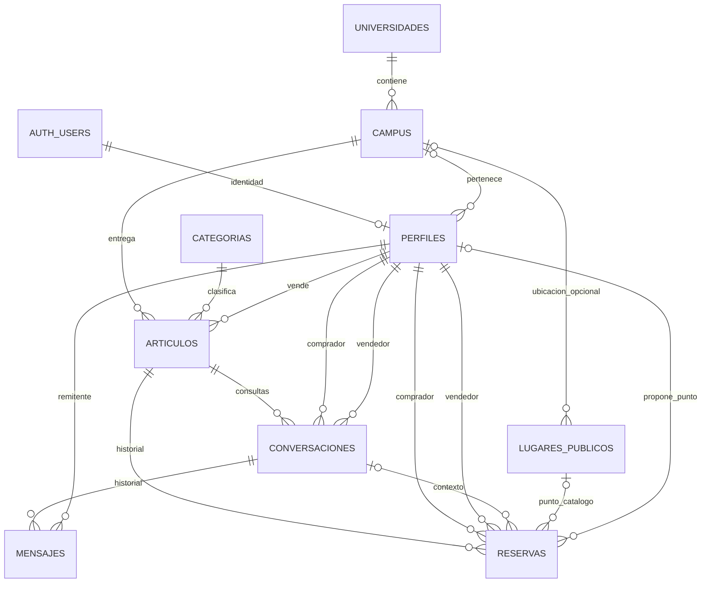

# CampusLoop TB4 — diseño para revisión (FASE 2)

Fecha: 13/11/2026 (Perú). Responsable: Bernabé.
Estado: PROPUESTA PENDIENTE DE APROBACIÓN. No es migración ni modifica contratos.
Base inspeccionada: `1b44bfb`, rama `feature/bernabe/esquema-rls`.

## Decisiones y compatibilidad

- Se conserva arquitectura C: Auth oficial, PostgreSQL/RLS/RPC, Storage y REST GET con fetch. No se modifica `js/auth.js` ni UI.
- Decisión explícita del usuario en esta conversación: lugares públicos externos sin campus; `lugares_publicos.campus_id` nullable. Se registra la excepción respecto al campus conocido propuesto en SPEC_TB4 §6.1, sin editar ese documento.
- Las siete funciones Auth son compatibles con el perfil mínimo: `id uuid` PK/FK a `auth.users.id`; nombre y campus inicialmente NULL; vendedor FALSE. Trigger sin datos de metadatos ni privilegios. Completar perfil solo con sesión auténtica y columnas autorizadas.
- El registro actual exige UUID de universidad y campus, pero solo valida su formato. La relación y actividad se comprobarán en el servicio de perfiles y servidor. No se duplica universidad en perfiles: se deriva de campus.
- No existen SQL/migraciones/semillas locales. La configuración pública está vacía. No se ha inspeccionado ni validado el esquema remoto.

## Diagrama propuesto: nueve tablas de aplicación

`auth.users` es infraestructura existente, no una décima tabla de aplicación.

FK de identidad con borrado restringido como propuesta: evitar cascadas que destruyan mensajes/reservas. Política futura de anonimización/borrado de cuenta requiere coordinación. Campus de artículo obligatorio no implica que el encuentro deba ocurrir allí.

## Manifiesto de UUID reservados para aprobación

Estos UUID v4 se generaron una sola vez y quedan fijados aquí. Las futuras semillas usarán literales, nunca generación al ejecutar. **No hay todavía registros aprobados como catálogo definitivo**: aprobar esta lista permitirá promover estos mismos IDs sin reemplazarlos. Los fixtures sintéticos de tests no son catálogos.

### Universidades propuestas

| UUID reservado | nombre propuesto | sigla | Evidencia local |
| --- | --- | --- | --- |
| `5a5623f3-6f07-4f15-97b8-2061cd5c61b3` | Pontificia Universidad Católica del Perú | PUCP | registro.html; explorar.html |
| `486a935d-f0f9-4437-891e-62bc48bde10a` | Universidad Peruana de Ciencias Aplicadas | UPC | explorar.html, sigla; nombre desarrollado pendiente de ratificar |
| `035d83f5-bf9d-4032-90e2-abd7a2172159` | Universidad Nacional Mayor de San Marcos | UNMSM | explorar.html, sigla; nombre desarrollado pendiente de ratificar |
| `6ab6b6a8-0f6b-4149-8036-30a56eba20ba` | Universidad de Lima | ULIMA | inicio.html y explorar.html: «U. de Lima»; sigla propuesta |

Campos: `id uuid`, `nombre text`, `sigla text`, `activa boolean`, `creado_en timestamptz`. Propuesta: nombre 3–150, sigla 2–20, activa TRUE, fecha del servidor. Unicidad separada por `lower(btrim(nombre))` y `lower(btrim(sigla))`; rechazar vacíos, espacios extremos y controles. No eliminar tildes automáticamente.

### Campus propuestos y relación

| UUID reservado | nombre | universidad_id | distrito | ciudad |
| --- | --- | --- | --- | --- |
| `6fc0d006-f5ec-4936-ab83-a15ef417c648` | San Miguel | `5a5623f3-6f07-4f15-97b8-2061cd5c61b3` | Por confirmar | Lima (propuesta) |
| `82d7186a-920c-49e2-bcc5-9aaa03ad655e` | Monterrico | `486a935d-f0f9-4437-891e-62bc48bde10a` | Por confirmar | Lima (propuesta) |
| `105fb795-dc41-4f56-8dce-baa386d3b021` | Campus Central | `035d83f5-bf9d-4032-90e2-abd7a2172159` | Por confirmar | Lima (propuesta) |
| `8214f236-d4ba-4b94-bcfe-bb029136a5cd` | Surco | `6ab6b6a8-0f6b-4149-8036-30a56eba20ba` | Por confirmar | Lima (propuesta) |

Nombres observados en explorar.html; «Campus San Miguel» también en cuenta.html. No inferir distrito desde nombre comercial; «Surco» y «Campus Central» requieren ratificación de etiqueta. No sembrar el texto «Por confirmar»: distrito/ciudad NULL hasta confirmación, si se aprueba esa nulabilidad.

Campos: `id uuid`, `universidad_id uuid NOT NULL` FK, `nombre text NOT NULL` (2–100), `distrito text NULL`, `ciudad text NULL` (2–100 cuando presentes), `activo boolean NOT NULL DEFAULT true`, `creado_en timestamptz` servidor. Unicidad por universidad + `lower(btrim(nombre))`. Desactivar catálogos conserva FK e historial; nuevas selecciones requieren campus y universidad activos.

### Categorías propuestas

| UUID reservado | nombre | descripcion propuesta | orden |
| --- | --- | --- | --- |
| `7065c00d-bfe8-4460-ae0c-6978fd7107d9` | Académico | Materiales y artículos de estudio | 1 |
| `cfc40a13-ce57-4532-969c-e21bd6737216` | Tecnológico | Equipos y accesorios tecnológicos | 2 |
| `27193cb6-fcc8-49f4-9992-0adcc2ec1b25` | Entretenimiento | Artículos de ocio y entretenimiento | 3 |

Evidencia de nombres: filtros de explorar.html. Campos: `id uuid`, `nombre text NOT NULL` (2–100), `descripcion text NULL` (hasta 300), `activa boolean NOT NULL DEFAULT true`, `orden integer NOT NULL CHECK >= 0`. Unicidad por nombre normalizado; orden no necesita ser único (desempate por nombre/id).

«Apuntes», «Laptops», «Audio», «Libros», «Tablets», «Calculadoras» y «Consolas» aparecen como etiquetas secundarias. Propuesta mínima: tres categorías principales; no crear subcategorías ni tabla adicional. Acordar cómo conservar esas etiquetas en presentación; nunca inferirlas desde IA o texto libre como categorías aprobadas.

Semillas futuras: upsert por UUID solo para filas de este manifiesto aprobadas; comprobar colisiones de nombre/UUID y abortar en vez de reasignar FK. No borrar catálogos omitidos ni modificar usuarios/artículos. Definir qué atributos administra la semilla antes de sobrescribir cambios administrativos. No sembrar lugares físicos sin lista aprobada.

## Contrato prioritario para Registro y catálogos

Propuesta para `js/perfiles.js` y servicio de catálogos de Bernabé, sin DOM. Todos los métodos async devuelven `{ ok, datos, error }`; fallo: datos NULL y error `{ codigo, mensaje }` seguro.

| Interfaz propuesta | Entrada | datos en éxito |
| --- | --- | --- |
| `consultarUniversidades()` | Ninguna | Array `{ id, nombre, sigla }`, solo activas |
| `consultarCampus(universidadId)` | UUID universidad activa | Array `{ id, universidadId, nombre, distrito, ciudad }`, campus activos |
| `consultarCategorias()` | Ninguna | Array `{ id, nombre, descripcion, orden }`, solo activas |
| `obtenerMiPerfil()` | Actor de sesión, nunca ID ajeno | `{ id, nombreVisible, campusId, vendedorActivado, creadoEn, actualizadoEn, version }` |
| `actualizarMiPerfil(datos)` | `{ nombreVisible, universidadId, campusId, versionEsperada }` | Perfil propio actualizado |

Orden universidades/campus por nombre e id; categorías por orden, nombre e id. Propuesta: lectura anónima de estos tres catálogos para Registro, escritura solo administrativa; catálogo de artículos/perfiles públicos solo para autenticados hasta otra decisión. Catálogos son las únicas listas accesibles antes del registro.

Nombre visible 2–100 tras trim, sin controles ni `< >`, coherente con Auth. Campus y universidad UUID válidos, activos y relacionados; servidor verifica relación y permisos, no confía en la UI. Universidad solo sirve para validar selección: no se persiste en perfiles. Perfil mínimo permite nombre/campus NULL; completar exige ambos. RLS/grants solo permiten nombre/campus; ni id ni vendedor ni versión/fechas admiten actualización libre. Conflicto de versión devuelve `CONFLICTO`; perfil ausente devuelve `NO_ENCONTRADO`, no crear otro desde navegador.

Errores: `VALIDACION`, `NO_AUTORIZADO`, `NO_ENCONTRADO`, `CONFLICTO`, `RED`, `LIMITE`, `CONFIGURACION`, `SERVIDOR`. Lista vacía válida devuelve `[]`; UUID mal formado falla antes de red; selección desactivada o incongruente es VALIDACION. Tras signUp sin sesión, UI pide completar al acceder: no guardar contraseña ni afirmar persistencia de nombre/campus.

Adaptación a `js/catalogo.js`: opciones universidades/categorías `{ id, etiqueta: nombre }`; campus `{ id, universidadId, etiqueta: nombre }`. Son adaptadores pendientes, no cambios al módulo de Angel. Maricielo consumirá los UUID en lugar de texto libre cuando integre Registro.

## Propuesta de columnas físicas de publicaciones

| Columna | Tipo y regla propuesta |
| --- | --- |
| `id` | uuid PK generado servidor |
| `vendedor_id` | uuid FK perfiles NOT NULL; derivado de auth.uid(), vendedor activado |
| `titulo` | text NOT NULL, trim 1–100 |
| `descripcion` | text NOT NULL, trim 1–1000 |
| `categoria_id` | uuid FK categorias NOT NULL; activa al seleccionar |
| `condicion` | text NOT NULL: nuevo, como_nuevo, buen_estado, usado |
| `precio_centimos` | integer NOT NULL, 0–2147483647; nunca float |
| `moneda` | text NOT NULL DEFAULT PEN, CHECK PEN |
| `campus_id` | uuid FK campus NOT NULL; activo al seleccionar |
| `imagen` | jsonb NOT NULL, un objeto Storage validado; sin arrays/base64 |
| `estado` | text NOT NULL: disponible, reservado, vendido; transiciones servidor |
| `eliminado_en` | timestamptz NULL, borrado lógico; excluido de lectura pública |
| `creado_en`, `actualizado_en` | timestamptz NOT NULL servidor |
| `version` | integer NOT NULL DEFAULT 1, positivo; incremento servidor |

`imagen`: propuesta `{ proveedor: 'supabase', bucket, ruta, url, ancho, alto, formato, bytes }`. Una foto obligatoria; bucket aprobado pendiente, ruta bajo UUID propietario, URL HTTPS del Storage autorizado, dimensiones/bytes positivos y formatos JPEG/PNG/WebP. Límite 5 MiB propuesto. Validar objeto y metadatos en servidor/Storage; un CHECK JSON no prueba existencia ni contenido del archivo. No crear/modificar buckets en esta fase. Sin tabla de imágenes adicional.

Accesorios/disponibilidad de publicar.html: propuesta incluirlos en descripción dentro de 1000 caracteres, sin columnas extras hasta acuerdo con Matías. Pantalla muestra 1/5 fotos: discrepancia histórica TB3; TB4 limita a una. No editar la pantalla en esta tarea.

Servicios propuestos: `crearArticulo({ titulo, descripcion, categoriaId, condicion, precioCentimos, campusId, imagen })` y `actualizarArticulo(id, cambios, versionEsperada)`. Retornan DTO camelCase con campos anteriores, fechas ISO y UUID sin cambios. Rechazar campos desconocidos/propietario/estados/moneda/fechas inyectados. Edición condicionada a titular vendedor y versión esperada; propuesta bloquear cambios mientras exista reserva activa. Activación vendedor mediante operación autorizada separada, con criterios pendientes.

`consultarCatalogo(filtros, { signal })`: fetch GET `/rest/v1/articulos`, select explícito de columnas anteriores autorizadas, sin select=*. Por defecto disponible/reservado/vendido visibles, siempre sin borrado lógico. Filtros permitidos: búsqueda de título (máximo 120), categorías UUID, universidad UUID vía campus, campus UUID, estados/condiciones enumerados, mínimo/máximo entero en céntimos; orden recientes/precio asc/precio desc con id de desempate; límite 24 y máximo 100, offset entero no negativo. Normalizar filtros de UI sin aceptar expresiones PostgREST arbitrarias. La relación campus/universidad se resolverá por FK/embebido explícito en fase 3.

`datos` de catálogo: array de DTO; no prometer total global sin conteo. Detalle mediante `obtenerArticulo(id)`. Mantener response.ok, try/catch, JSON validado, cancelación y errores controlados del SPEC §8. Foto y etiquetas se adaptan al contrato de presentación existente; no exponer correo. Nombres SQL `imagen`, `precio_centimos`, `categoria_id`, `campus_id`, `vendedor_id`, `creado_en` conservan compatibilidad con el ejemplo REST aprobado. No se ha ejecutado GET real.

## Límites previstos para el resto del modelo

- Perfiles: campos mínimos del contrato + versión; sin credenciales. Catálogos privados de cuenta no se mezclan con lectura pública; grants por columna o vista segura pendiente de revisión.
- Conversaciones: UUID, articulo_id, comprador_id, vendedor_id, creado_en; participantes distintos e inmutables, vendedor derivado del artículo, comprador de Auth; UNIQUE de esa terna.
- Mensajes: UUID idempotente, conversacion_id, remitente_id derivado de Auth, texto 1–1000, creado_en; participantes exclusivamente, sin edición/borrado en mínimo.
- Lugares públicos: UUID, campus_id NULL, nombre 3–100, referencia_publica hasta 150, activo, creado_en; catálogo administrativo sin afirmar verificación física.
- Reservas: UUID, articulo_id, comprador_id, vendedor_id, conversacion_id NULL, estado, lugar_publico_id NULL, lugar_personalizado_nombre NULL (3–100), lugar_referencia_publica NULL (hasta 150), punto_propuesto_por NULL (participante), estado_punto, fechas servidor y versión.
- Propuesta de punto: sin punto (todos los campos de punto NULL, estado sin_proponer), catálogo (FK y sin nombre personalizado), o personalizado (nombre y referencia pública no vacía, sin FK). Proponer exige actor participante; aceptar solo contraparte; nueva propuesta reinicia aceptación. Estados propuesto/aceptado; estado_punto no prueba seguridad física. Campus opcional en catálogo; personalizados no necesitan campus. No GPS/direcciones privadas; validación estructural no puede garantizar por sí sola que una referencia no sea privada.
- Reserva pendiente/confirmada activa; completada/cancelada terminal. Propuesta para revisión: comprador reserva; vendedor confirma y completa; cualquiera de los dos cancela activa. RPC bloquea artículo primero, valida identidad/versión/disponibilidad y crea reserva/cambia estado en una transacción. Índice único parcial por articulo_id en pendiente/confirmada. Cancelar con mismo orden de bloqueo libera artículo; completar marca vendido. Coherencia de participantes y conversación se valida servidor. Sin updates libres de estados.

## Revisión necesaria antes de FASE 3

1. Aprobar manifiesto, nombres completos/siglas, etiquetas de campus y tres categorías principales; confirmar distrito/ciudad o su nulabilidad. Hasta entonces todos los UUID son reservas de diseño, no registros definitivos aprobados.
2. Aprobar lectura anónima de catálogos para Registro y lectura autenticada de artículos/perfiles; alcance de campos públicos.
3. Congelar condiciones, límite/precio cero, metadatos y tamaño de foto, y tratamiento de etiquetas secundarias/accesorios.
4. Aprobar actores/transiciones de reserva/punto, activación vendedor y política de borrado de cuenta con historial.
5. Revisar este diseño con Maricielo, Matías y Angel por los canales que Bernabé decida. Este trabajo no envía mensajes a terceros.

Tras aprobación: preparar SQL versionado, índices, trigger mínimo, RLS/grants, RPC y pruebas aisladas. No hay SQL ejecutable ni semillas implementadas en FASE 2. Aplicar a Supabase remoto y commit/push/PR/merge siguen fuera de autorización.

## Verificación realizada

FASE 1: fetch origin, comparación Git sin divergencia; ancestro 388b9f8 confirmado; suite Auth aislada 44/44 y diff --check correctos. FASE 2: lectura de HTML, consumidor catalogo.js y fixtures; UUID fijados una vez en el manifiesto. No pruebas SQL/RLS/Storage/REST/concurrencia ni validación remota. El diagrama es documental; no se ha comprobado con renderizador Mermaid.
