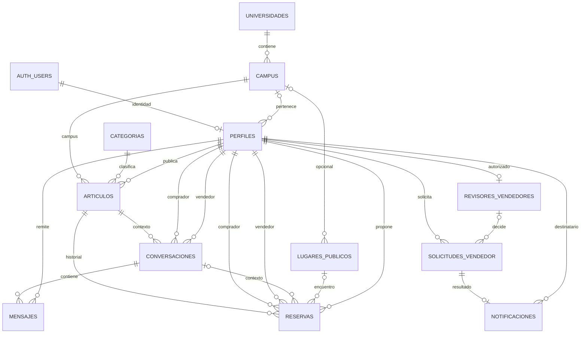
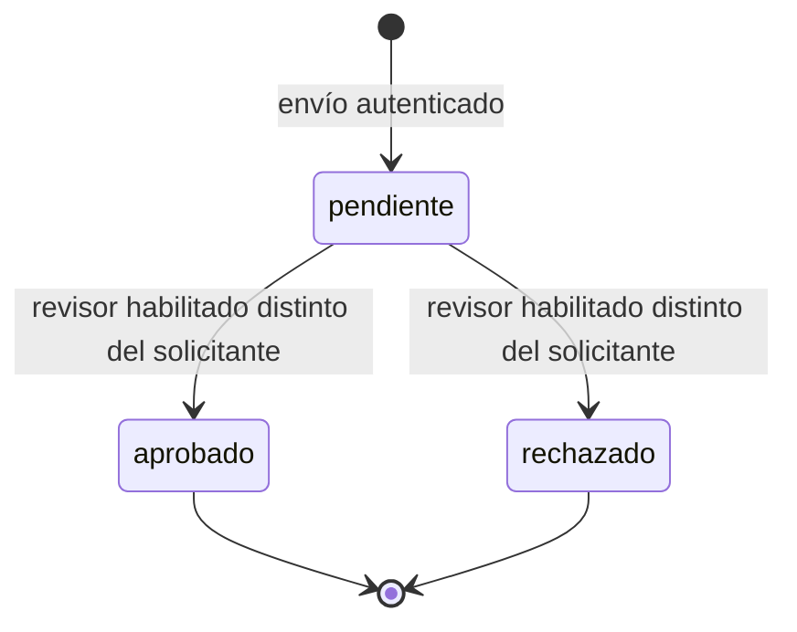

# CampusLoop V2 — propuesta de activación manual de vendedores

Actualización documental: 15/11/2026, Perú. Responsable técnico: Bernabé.
Estado: DISEÑO PARA REVISIÓN DE COORDINACIÓN. No autoriza implementación.
Fuente de reglas: aclaración definitiva de coordinación transmitida en esta tarea.
Se conservan los contratos aprobados, las migraciones y los cambios locales previos.
Este documento no contiene migraciones ni políticas ejecutables.

## 1. Reglas y alcance

Una cuenta de estudiante conserva siempre sus capacidades de comprador. Ser vendedor
es una capacidad adicional del mismo perfil, no otra cuenta ni un rol excluyente.
Con o sin experiencia y sin enlaces comerciales, el estudiante puede solicitarla.
La ausencia de ventas previas, portafolio o enlaces comerciales no impide el envío. Toda decisión requiere
personal autorizado: estados exactamente `pendiente`, `aprobado`, `rechazado`.
El estudiante podrá proporcionar enlaces a sus páginas de venta de forma
completamente opcional. Son información complementaria para los revisores humanos,
nunca un requisito obligatorio ni un criterio automático de aprobación. Omitirlos
no impide solicitar, incluso sin experiencia. La representación, persistencia y
validación de esos enlaces se definirán con coordinación y frontend antes de
implementar; esta precisión no añade columnas ni cambia las firmas conceptuales
de RPC o los contratos de esquema pendientes de aprobación.
No hay aprobación automática por experiencia, tiempo transcurrido, registro ni
confirmación de correo. El resultado se guarda como notificación interna persistente;
no se envía correo de aprobación. Publicar requiere aprobación efectiva.

El plazo máximo definitivo es de 48 horas corridas desde el envío, incluidos
fines de semana y feriados, sin hora de corte. Se propone registrar en servidor
responder_antes_de = enviada_en + 48 horas. Vencerla NO cambia el estado:
la solicitud sigue pendiente, se muestra vencida y se escala al personal. Una decisión
tardía se registra como tal; no se rechaza una decisión manual por llegar tarde.
La fecha límite y una cola ordenada no garantizan por sí solas el plazo: hacen falta
responsable, cobertura y seguimiento operativo. Un recordatorio puede automatizarse;
una aprobación nunca. No se incluye infraestructura programada en esta propuesta.

## 2. Compatibilidad y diferencias con la base actual

| Fuente inspeccionada | Compatibilidad o cambio que requiere acuerdo |
| --- | --- |
| SPEC_TB4 §6.1–6.2 | Conserva identidad Auth, autorización servidor y booleano protegido. Concreta activación pendiente de definir, sin conceder verificación institucional automáticamente. |
| SPEC_TB4 §5 y responsabilidades | Bernabé diseña servicios/BD; Matías integra vendedor/publicación. No cambia Auth de Angel ni interfaces de otros integrantes. |
| Contrato Auth/perfiles §3 y §5 | Compatible: perfil mínimo FALSE, sin privilegios de metadatos y operación autorizada separada. Las siete firmas Auth no cambian. |
| Diseño de catálogos FASE 2 | Sustituye la indefinición de activación con revisión manual. La propuesta pasaría de nueve a doce tablas de aplicación si se aprueban las tres nuevas. |
| Migraciones de Etapa A | No contienen solicitudes/notificaciones/revisores. Se conservan; cualquier implementación futura sería aditiva. |
| Trigger B/A | Sigue insertando solo el UUID; defaults mantienen FALSE. No crea solicitudes ni decide activaciones. |
| activar-vendedor.html | Ya admite sin experiencia, pero Enviar solicitud enlaza directamente a activo. Ese enlace deberá convertirse, por su responsable, en envío y vista pendiente. No se modifica aquí. |
| activar-vendedor-activo.html | Solo debe mostrar activación tras lectura autorizada del servidor; acceder a una URL no concede permisos. |
| IA existente | El servidor contempla verificarVendedor: debe consultar autorización efectiva, sin confiar en estado local ni experiencia. |

No se encontró un mecanismo local de administración de revisores en migraciones,
servicios o contratos inspeccionados. Esto no inventaría el estado del Supabase remoto:
no se consultó. Membresía del dashboard, roles anon/authenticated, vendedor_activado
y metadatos editables no equivalen a autorización para revisar estudiantes.

## 3. Diagrama de entidades propuesto

Se muestran las nueve tablas actuales y las tres propuestas. AUTH_USERS pertenece
a infraestructura Auth. La FK opcional del revisor conserva quién decidió aunque
posteriormente se deshabilite su autorización.

La cardinalidad de notificación es cero mientras pendiente y exactamente una al
decidir. La existencia obligatoria en terminales se garantiza mediante la operación
transaccional protegida; no mediante una FK sola.

## 4. Tablas y restricciones propuestas

### solicitudes_vendedor

| Columna | Tipo conceptual y regla |
| --- | --- |
| id | UUID PK generado servidor |
| solicitante_id | UUID FK perfiles, obligatorio; derivado de auth.uid() |
| clave_idempotencia | UUID del cliente; único junto a solicitante_id para reintentos |
| tiene_experiencia | Boolean obligatorio; informativo, nunca criterio de autoaprobación |
| campus_id_al_enviar | UUID FK campus; copia de la selección del perfil al enviar, no editable |
| normas_version | Texto acotado; versión publicada de normas aceptada, validada por servidor |
| normas_aceptadas_en | timestamptz servidor al aceptar y enviar |
| estado | Texto enumerado: pendiente inicialmente; aprobado/rechazado terminales |
| enviada_en | timestamptz servidor |
| responder_antes_de | timestamptz servidor, posterior al envío; enviada_en + 48 horas corridas |
| revisor_id | UUID FK revisores_vendedores.perfil_id, NULL mientras pendiente |
| decidida_en | timestamptz, NULL mientras pendiente, >= enviada_en al decidir |
| motivo_decision | Texto plano 1–1000; propuesta: obligatorio en toda decisión y visible al solicitante |
| version | Entero positivo, inicial 1; incrementado por servidor al decidir |

Una única pendiente por solicitante mediante unicidad condicional, incluso con
peticiones concurrentes. Como no se propone revocación de vendedor, una única aprobada histórica
por solicitante; múltiples rechazadas se conservan. Pendiente implica revisor,
decidida_en y motivo NULL; terminal implica los tres presentes. Revisor distinto
del solicitante. Toda FK de historial con borrado restringido, sin cascadas.
No se permite editar datos enviados, eliminar ni reabrir terminales. Tras rechazo
se propone nueva solicitud con nuevo UUID, sin alterar la anterior; política de
reintento/cupo pendiente de aprobación. Ya aprobado no puede volver a solicitar.

No se propone JSONB libre ni almacenar documentos, contraseñas, tokens o correos
duplicados. La experiencia y las normas son datos explícitos; campos adicionales de
verificación deben acordarse antes de implementación. No exigir ventas previas ni
evidencias de experiencia a quien empieza. La revisión institucional es distinta:
sus criterios y evidencias mínimas todavía requieren definición.

### revisores_vendedores

| Columna | Tipo conceptual y regla |
| --- | --- |
| perfil_id | UUID PK/FK perfiles; misma identidad Auth, sin cuenta paralela obligatoria |
| habilitado | Boolean, FALSE por defecto; solo administración confiable lo cambia |
| creado_en | timestamptz servidor |
| actualizado_en | timestamptz servidor |
| habilitado_por | UUID FK auth.users, actor administrativo identificable |
| motivo_autorizacion | Texto 1–500 para trazabilidad administrativa |
| version | Entero positivo servidor, para control de cambios administrativos |

Propuesta mínima: lista especializada de autorizaciones, sin crear roles PostgreSQL
por persona ni un sistema RBAC general para una sola capacidad. Un revisor puede
seguir comprando y solicitar ser vendedor, pero otro revisor debe decidir su caso.
Deshabilitar en vez de borrar preserva decisiones históricas. Los campos anteriores
describen el estado administrativo actual, no una bitácora completa de cada cambio;
la auditoría de altas/bajas debe quedar en el procedimiento administrativo acordado.

Si coordinación demuestra un registro administrativo existente y confiable,
reutilizar su permiso específico `revisar_vendedores`, con auditoría y revocación,
y omitir esta tabla: serían once tablas de aplicación, no doce. No duplicar
fuentes de autoridad. Claims administrados en servidor son una alternativa, pero
su vigencia y revocación deben resolverse; se prefiere consulta transaccional de
autorización actual. No se adopta ningún mecanismo remoto sin inventariarlo.

El alta inicial y la baja de revisores serían operaciones administrativas privadas,
fuera de las RPC del estudiante. No hay autoinscripción de revisores ni concesión
mediante raw_user_meta_data. Coordinación designa a los revisores y administradores; no se delega esa
designación al solicitante. Falta identificar a las personas y aprobar el
procedimiento técnico de altas y bajas antes de implementar.

Propuesta de procedimiento, todavía sin implementar:

1. Coordinación designa expresamente administradores y revisores. No constan
   nombres, usuarios ni autorizaciones ya concedidas en la evidencia de esta
   ronda; la designación de personas queda pendiente de coordinación.
2. Un administrador designado habilitaría únicamente el permiso específico
   `revisar_vendedores` tras verificar la decisión de coordinación. Registrar
   actor, destinatario, fecha y motivo, con el mecanismo administrativo que se
   apruebe; no crear otro esquema de permisos en esta corrección.
3. La revocación deshabilitaría ese permiso para decisiones futuras, conservando
   expedientes y decisiones anteriores. Cada decisión debe volver a comprobar
   la habilitación vigente y coordinarse con bajas concurrentes, como propone
   la sección 6. Esta revocación afecta a revisión, no diseña revocación de vendedor.
4. No se permite autoasignación. Los solicitantes no pueden asignar ni modificar
   permisos de revisores. La administración tampoco deriva autoridad de campos
   enviados por el solicitante ni de metadatos editables.

El procedimiento requiere ratificación de coordinación y autorización de
implementación separada. No se crean permisos, GRANTS, RPC ni cuentas en esta tarea.

### notificaciones

| Columna | Tipo conceptual y regla |
| --- | --- |
| id | UUID PK generado servidor |
| usuario_id | UUID FK perfiles, destinatario obligatorio |
| solicitud_vendedor_id | UUID FK solicitudes_vendedor; obligatorio en este alcance |
| tipo | vendedor_aprobado o vendedor_rechazado |
| creada_en | timestamptz servidor, instante de la decisión |
| leida_en | timestamptz NULL; solo servidor al marcar lectura, >= creada_en |

Una notificación de resultado por solicitud: unicidad de solicitud_vendedor_id.
La relación compuesta solicitud/destinatario debe asegurar que usuario_id es el
solicitante. El tipo corresponde a la decisión inmutable de la solicitud. No admitir
texto libre ni destinatario desde el cliente; el mensaje se genera con plantillas
controladas y el motivo se recupera de la solicitud. Si se necesita guardar texto
histórico exacto, aprobar una versión de plantilla antes de añadir contenido.

Esta primera versión de notificaciones cubre exclusivamente activación. No se
convierten otros eventos de la aplicación en funcionalidades implícitas.

## 5. Cuenta única y autorización efectiva

perfiles.id PK/FK auth.users asegura un perfil por identidad Auth. No demuestra una
cuenta por persona: el mismo estudiante podría registrar dos correos. No afirmar que
email confirmado equivale a identidad institucional única. Coordinación debe elegir
un identificador estudiantil verificable, su ámbito (universidad + código, por
ejemplo), tratamiento de privacidad y procedimiento de detección/regularización.
Si se acuerda persistirlo, requerirá un registro privado con unicidad en servidor y
acceso restringido; no añadirlo a la proyección pública de perfiles ni introducirlo
silenciosamente como otra tabla en este diseño. Mientras tanto la regla de negocio
es obligatoria, pero no queda garantizada técnicamente por la propuesta mínima.

vendedor_activado permanece FALSE al registrar, enviar y rechazar. Aprobar cambia
el booleano a TRUE junto con la decisión y la notificación en una sola transacción.
La solicitud aprobada es la evidencia; el booleano es su proyección de autorización.
La condición efectiva propuesta exige ambos: booleano TRUE y aprobación válida.
Si están desalineados, denegar publicación e investigar; no aprobar ni reparar
automáticamente desde frontend. El servidor también debe proteger campos privados,
identidad, fechas y versión. El servicio de completar perfil no toca vendedor_activado.

No se diseña aquí suspensión/revocación de vendedor. Su incorporación futura debe definir qué
pasa con publicaciones existentes y con el historial; no reinterpretar rechazado
como revocación de una aprobación previa. Datos/semillas con vendedores TRUE sin
aprobación deberán inventariarse y regularizarse mediante revisión explícita, sin
inventar aprobaciones retrospectivas ni borrar historial.

## 6. Estados, transacciones y concurrencia

Un rechazo permite proponer un nuevo expediente, no una transición del anterior.
Vencimiento y leído son propiedades independientes, no nuevos estados de solicitud.

Envío: derivar solicitante de Auth, bloquear su perfil, validar datos/aceptación,
comprobar que no esté activo/aprobado, resolver idempotencia e insertar pendiente.
Una clave repetida con mismos datos devuelve el expediente original; con datos
distintos devuelve CONFLICTO. Otra clave con pendiente devuelve SOLICITUD_PENDIENTE.
El índice de unicidad respalda la comprobación ante carreras.

Decisión: derivar revisor de Auth, bloquear y comprobar su autorización actual;
obtener solicitante inmutable, bloquear perfil y después solicitud, revalidando
estado y versión. Orden global propuesto para decisiones: autorización revisor,
perfil solicitante, solicitud. Envíos bloquean perfil antes de insertar solicitud;
bajas administrativas toman el mismo bloqueo de autorización. Una baja concurrente
se ordena antes o después de la decisión, no se confía en una comprobación antigua.
No se adquieren bloqueos en orden inverso en operaciones futuras.

Validar revisor != solicitante, pendiente y versión esperada. Escribir decisión,
fecha, motivo y versión; si aprobado, actualizar perfil y su versión/fecha; insertar
notificación vinculada. Commit único: cualquier fallo revierte TODO. Rechazo conserva
FALSE y las capacidades de comprador. No llamadas frontend separadas para estos pasos.
Dos revisores concurrentes: solo uno decide; el otro recibe CONFLICTO sin notificación
duplicada. Una repetición idéntica por el mismo revisor puede devolver la decisión ya
guardada; distinto resultado, motivo o revisor devuelve CONFLICTO. No se sobrescribe.

## 7. Contratos conceptuales de RPC y servicios

Nombres propuestos, no interfaces aprobadas ni SQL ejecutable. Identidad siempre
desde auth.uid(); no aceptar solicitante_id, revisor_id, estado inicial ni fechas.
Servicios frontend retornan `{ ok, datos, error }`, DTO camelCase, UUID originales
y fechas ISO. Errores seguros sin datos de otras cuentas ni detalles SQL.

| Operación conceptual | Entrada permitida | Resultado y controles |
| --- | --- | --- |
| enviar_solicitud_vendedor | claveIdempotencia, tieneExperiencia, aceptaNormas=true, normasVersion | Solicitud propia pendiente; campus leído de perfil; identidad/situación validada servidor |
| consultar_mis_solicitudes | cursor, limite acotado | Historial propio con estado, fecha límite, decisión y motivo; no necesita ID de otro usuario |
| consultar_solicitudes_revision | estado opcional, cursor, limite acotado | Cola para revisor habilitado; ordenar pendientes por fecha límite y UUID; excluye expedientes propios |
| aprobar_solicitud_vendedor | solicitudId, versionEsperada, motivo | Decisión + activación + notificación atómicas |
| rechazar_solicitud_vendedor | solicitudId, versionEsperada, motivo | Decisión + notificación atómicas; no activa vendedor |
| consultar_mis_notificaciones | cursor, limite, soloNoLeidas opcional | Notificaciones del actor; contenido generado y enlace interno por UUID validado |
| marcar_notificacion_leida | notificacionId | Solo titular; fija leida_en servidor una sola vez, reintentos conservan la primera fecha |

Lecturas pueden implementarse con SELECT explícito bajo RLS o RPC; elegir una
interfaz por servicio sin duplicar reglas. DTO de solicitud del titular incluye
id, tieneExperiencia, campusIdAlEnviar, normasVersion, estado, enviadaEn,
responderAntesDe, decididaEn, motivoDecision y version. El identificador interno
del revisor no es necesario para ese DTO; se reserva para auditoría autorizada.
DTO notificación: id, solicitudId, tipo, mensaje, creadaEn, leidaEn. Lista vacía es
éxito, no fallo. El estado efectivo se obtiene de perfil/evidencia servidor.

Códigos propuestos: VALIDACION, NO_AUTORIZADO, NO_ENCONTRADO (también ID ajeno),
SOLICITUD_PENDIENTE, YA_ACTIVADO, CONFLICTO, LIMITE, RED, SERVIDOR. Los nuevos códigos
de negocio pertenecen al servicio vendedor, sin cambiar el contrato Auth.

## 8. RLS y GRANTS propuestos

| Recurso | Anónimo | Autenticado titular | Revisor habilitado | Escritura |
| --- | --- | --- | --- | --- |
| solicitudes_vendedor | Nada | Solo solicitudes propias y columnas autorizadas | Cola/detalle ajenos necesarios para revisar | Solo RPC de envío/decisión; sin INSERT/UPDATE/DELETE directo |
| notificaciones | Nada | Solo propias | Sin acceso a notificaciones ajenas por ser revisor | Inserción interna de decisión; lectura solo mediante RPC de marcado |
| revisores_vendedores | Nada | Sin listado | Solo consulta mínima de su propia habilitación mediante función | Administración privada confiable, sin DML frontend |
| perfiles | Según matriz pública aprobada | Editar exclusivamente datos de perfil permitidos | No concede edición general de perfiles ajenos | vendedor_activado solo operación de aprobación |
| articulos | Según futura matriz de catálogo | Crear solo como titular efectivamente aprobado | Ser revisor no concede publicaciones ajenas | Validación de vendedor en servidor; conservar reglas de estados/reservas |

En notificaciones, «lectura» en la columna Escritura significa marcar como leída,
no cambiar destinatario, tipo, solicitud ni fecha de creación. No DELETE del cliente.
No ampliar lectura pública de perfiles por necesidades privadas de revisión.

RLS limita filas; SELECT por columna o proyección/RPC segura limita campos. Si una
RPC elevada ofrece DTO distintos por actor, validar autorización dentro de ella;
no presumir que su elevación queda limitada por RLS. Revocar grants de tabla generales
antes de conceder columnas: un grant general no se neutraliza omitiendo una columna.
Sin EXECUTE para PUBLIC/anon; conceder solo RPC necesarias a authenticated, con
verificación del permiso de revisor en cada llamada de decisión. Helpers internos
no invocables desde API, search_path fijo y referencias calificadas. Propietario
administrativo controlado, separado del rol navegador. Nunca service_role frontend.

La comprobación de revisores debe evitar recursión entre políticas: helper mínimo
que consulte la autorización y no use una política que vuelva a llamarse. No derivar
autoridad de permisos del navegador, UUID de revisor enviado o metadatos de usuario.
Comprobar tanto USING como WITH CHECK donde haya escritura directa permitida.
El trigger Auth conserva su contexto controlado, independiente del rol solicitante;
las pruebas locales ya mostraron que FORCE RLS sin política/BYPASSRLS puede bloquear
su inserción. La implementación futura debe preservar su funcionamiento deliberadamente.

## 9. Flujo de notificación y frontend

Recorrido definitivo a implementar: las notificaciones se consultan desde la
campana junto al avatar, con acceso al resultado e historial propio. Tras consultar
la autorización efectiva: **perfil vendedor activo → Publicar artículo → formulario
de publicación**. Estas decisiones no acreditan una integración funcional; su
implementación corresponde a los responsables frontend, sin modificar sus módulos
en esta tarea.

El commit de decisión hace visible resultado, autorización y notificación a la vez.
Realtime es opcional para avisar de cambios; al entrar/recargar se consulta historial
durable y no leídos. Sincronizar/deduplicar por UUID, no crear notificaciones al recibir
un evento ni al abrir la página. No se envía correo de aprobación ni se configura un
proveedor de correo para este flujo. El correo de confirmación Auth sigue siendo un
flujo independiente existente.

Matías integraría el formulario vendedor: respuesta pendiente, plazo visible y
experiencia informativa. No navegar a activo al enviar. Mostrar rechazo/motivo e
historial; activar Publicar solo tras consultar autorización efectiva. Ante sesión
expirada, cargar estado antes de habilitar acciones. El servidor siempre vuelve a
comprobar la aprobación al publicar, aunque se manipule la UI o se llame REST directo.

Servicio compartido de solicitudes/notificaciones de Bernabé, cliente único de Angel
y ninguna duplicación Auth. Responsable de bandeja/revisión y navegación a acordar.
Mensajes de texto mediante textContent; no HTML del motivo. No persistir solicitudes,
evidencias o privilegios en localStorage como fuente de verdad. Borrador local
permitido solo con datos no sensibles y sin activar funciones. Proteger igualmente
uploads de publicación para no habilitar una vía alternativa sin aprobación.

## 10. Validación futura y decisiones para coordinación

No se ejecutaron pruebas de implementación en esta tarea: el documento es conceptual.
Las pruebas previas del trigger fueron locales y no validan este flujo. No se
inspeccionó ni ejecutó SQL en Supabase compartido.

Las reglas definitivas anteriores no quedan pendientes de ratificación. Antes
de implementar, coordinación debe aprobar el esquema y los contratos propuestos
y concretar los siguientes aspectos pendientes:

1. Tres tablas nuevas (doce totales) o reutilización demostrada de autorización
   administrativa existente. Identificar quién habilita/deshabilita revisores,
   quiénes atienden la cola y la auditoría de esas acciones.
2. Cobertura humana y escalamiento para cumplir las 48 horas corridas desde el
   envío, ya definitivas. El vencimiento nunca activa aprobación automática.
3. Identificador y verificación para una cuenta por estudiante; criterios de revisión
   institucional, privacidad/retención y regularización de duplicados. No usar
   experiencia como barrera de acceso ni declarar que la unicidad Auth resuelve esto.
4. Campos mínimos de solicitud, versión de normas y motivo visible obligatorio.
   No recolectar documentos/evidencias adicionales sin justificar necesidad y protección.
5. Permitir nueva solicitud tras rechazo y sus límites; no incluir revocaciones de vendedor sin
   un flujo adicional acordado.
6. Proyección pública/privada, interfaz de revisores y responsables frontend. Ratificar
   contratos RPC y control conjunto de booleano/evidencia antes de cerrar RLS/GRANTS.
7. Inventario y regularización explícita de vendedores previamente activos si existen;
   procedimiento de borrado/anonimización con historial restringido.

Pruebas a preparar después de aprobación: anónimo y tres identidades independientes;
revisor propio/ajeno/deshabilitado/suplantado; DML directo denegado; una pendiente
concurrente; dos revisores y baja concurrente; rollback si falla notificación o perfil;
reintentos idempotentes; plazo sin autoaprobación; titular de notificación y marcado
de lectura; publicar denegado con FALSE o sin evidencia; comprador conservado tras
rechazo/aprobación. Primero PostgreSQL desechable con Auth simulado, luego pruebas
GoTrue/REST/Realtime reales solo con autorización separada y evidencia diferenciada.

No se crean tablas, migraciones, políticas, commits ni push como parte de esta propuesta.
